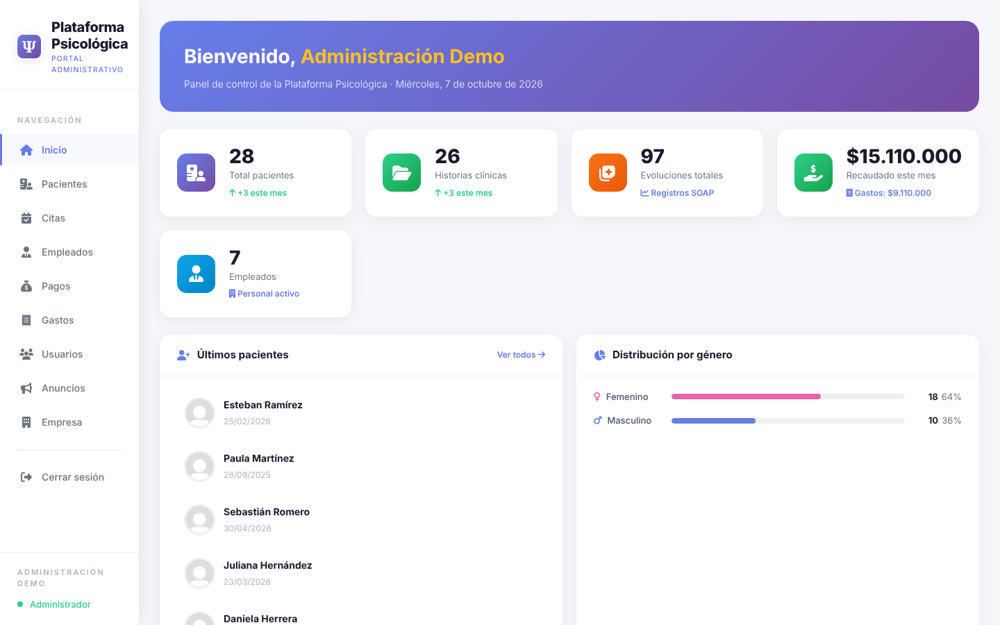
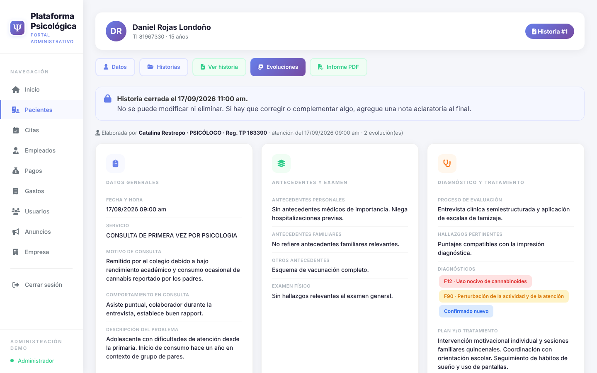
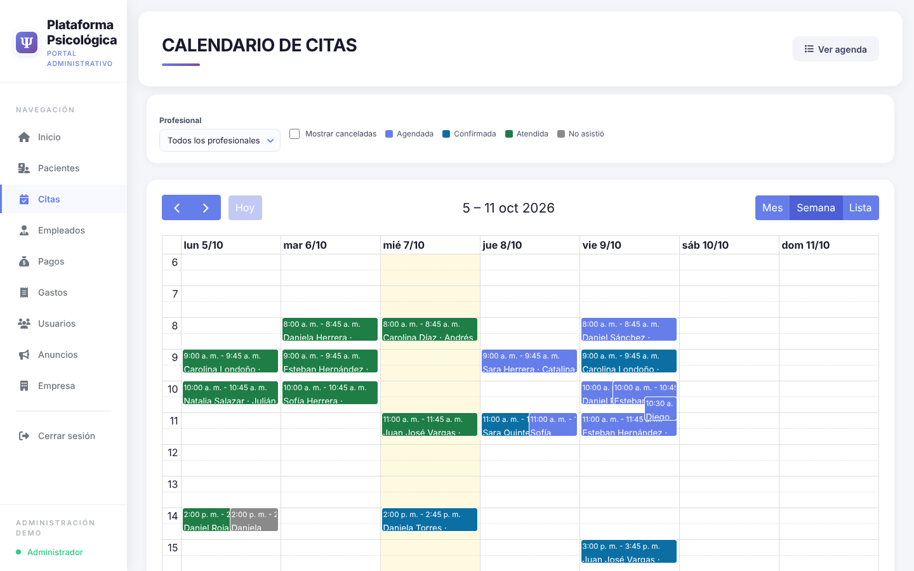
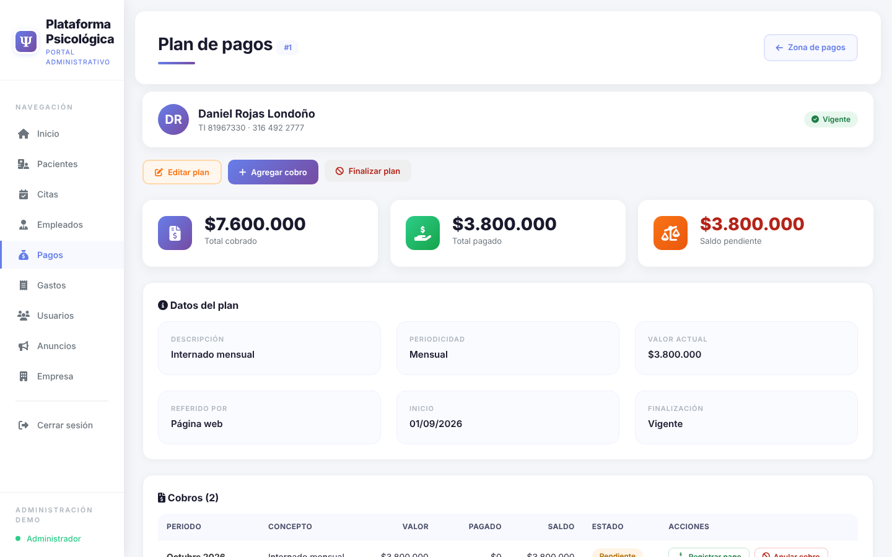
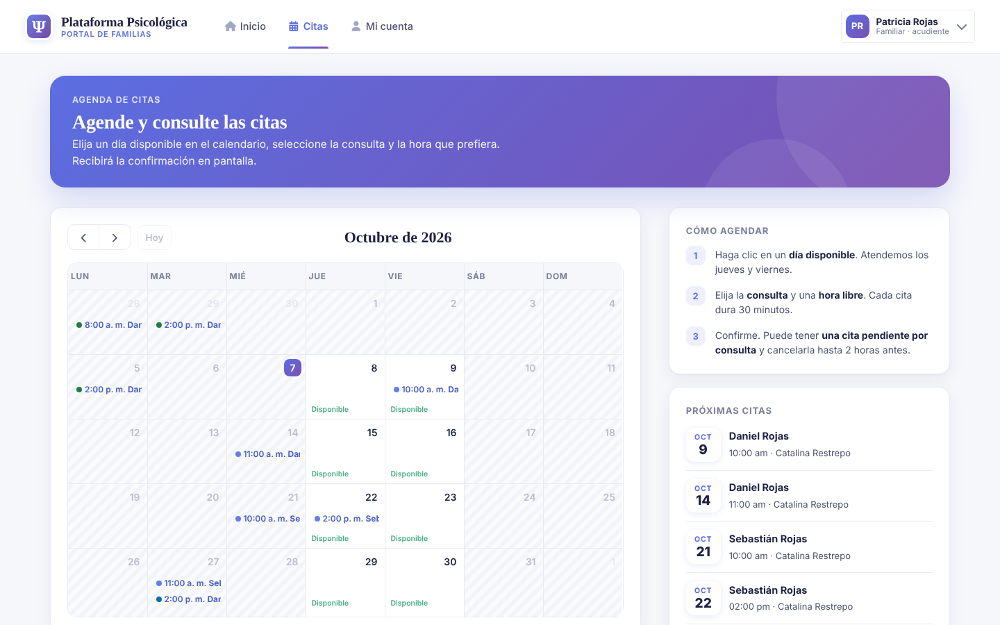

# Plataforma Psicológica · gestión para centros de atención psicológica

**[▶ Abrir la demo en vivo](https://USUARIO.github.io/plataforma-psicologica-demo/)** · datos 100 % ficticios · no requiere registro

Plataforma Psicológica es un sistema web para centros de atención psicológica y de adicciones. Reúne en un solo lugar la ficha del paciente, la **historia clínica con firma y cierre**, las evoluciones de cada sesión, la agenda del equipo, un **portal para las familias** con agendamiento en línea, y el control de pagos y gastos con recibos en PDF.

Este repositorio contiene una **demo navegable** de la aplicación. Cada pantalla la generó la aplicación real con una base de datos de prueba. Así se ve y se comporta como el producto, pero corre en GitHub Pages sin servidor.

## Cómo probarla

1. Abra la [demo](https://USUARIO.github.io/plataforma-psicologica-demo/).
2. Elija un perfil en la pantalla de ingreso:
   - **Administración**: pacientes, historia clínica, citas, empleados, pagos, gastos, usuarios y anuncios.
   - **Familia**: portal de acudientes, donde puede **agendar y cancelar citas** de verdad (la cita se guarda en su navegador).
3. También puede ingresar con `admin` o `familia` y la clave `demo1234`.

Los formularios que guardan información muestran una **acción simulada**: en la demo no hay base de datos detrás. Los buscadores y filtros sí funcionan.

## Qué muestra

| Módulo | Qué se puede ver |
|---|---|
| **Pacientes** | Fichas completas, acudientes, profesionales asignados, buscador y filtros |
| **Historia clínica** | Historia por áreas (personal, familiar, social…), diagnósticos CIE-10, estado *borrador → cerrada*, notas aclaratorias e **informe en PDF** |
| **Evoluciones** | Registro SOAP de cada sesión, firmado por el profesional |
| **Citas** | Agenda por profesional, estados (agendada, confirmada, atendida, no asistió) y calendario semanal/mensual |
| **Portal de familias** | Anuncios, próximas citas y **agendamiento en línea** con validación de días, horas libres y cruces |
| **Pagos** | Planes → cobros → abonos parciales, saldos, estadísticas por año y **recibos de caja en PDF** |
| **Gastos** | Registro por categoría, resumen mensual e ingresos vs. egresos |
| **Personal y accesos** | Empleados con registro profesional, cargos, usuarios y roles |

<table>
<tr>
<td></td>
<td></td>
</tr>
<tr>
<td></td>
<td></td>
</tr>
</table>

## Decisiones técnicas destacadas

- **Historia clínica inalterable (Res. 1995/1999).** Una vez cerrada, la historia no se edita ni se borra; las correcciones van en notas aclaratorias. Lo impone la **base de datos con *triggers***, no solo la aplicación.
- **Seguridad desde la estructura.** `public/` es la única carpeta expuesta. Todo el SQL usa consultas preparadas, hay token CSRF en cada POST, los permisos por rol están en un solo lugar y las imágenes subidas se validan, se recodifican y se guardan fuera del *DocumentRoot*.
- **Auditoría.** Queda registrado quién vio, creó, editó, cerró o exportó cada registro clínico.
- **Nada se borra.** Los pagos se anulan; pacientes, empleados y gastos se archivan.
- **Agenda sin cruces.** Un *trigger* impide que un profesional tenga dos citas en el mismo horario.
- **Migración real.** La versión 2 incluye el script que migró la base anterior (300+ pacientes, ~4.900 evoluciones, pagos y gastos) sin pérdida de información.
- **Hosting sencillo.** PHP puro, sin framework ni dependencias, pensado para un hosting cPanel compartido.

**Stack:** PHP 8 (compatible 7.4) · MariaDB / MySQL · Bulma · FullCalendar · FPDF · JavaScript sin frameworks

## Cómo está hecha esta demo

La aplicación real se ejecutó con una base de datos llena de datos inventados (28 pacientes, 26 historias, ~100 evoluciones, ~200 citas, ~115 pagos). Cada pantalla se exportó a HTML estático, y los recibos e informes a PDF. Encima va una capa de JavaScript (`docs/demo/demo.js`) que:

- simula el inicio de sesión por perfil,
- lleva los filtros y buscadores a la página exportada equivalente,
- simula la API del portal para agendar y cancelar citas,
- muestra un aviso cuando una acción guardaría datos en la versión real.

La fecha de la demo queda fija en el día en que se generó, para que la agenda y los cobros siempre se vean al día.

El código fuente de la plataforma no está publicado en este repositorio.

## Publicar con GitHub Pages

*Settings → Pages → Build and deployment → Source: Deploy from a branch → `main` / `/docs` → Save.* En uno o dos minutos la demo queda en `https://USUARIO.github.io/plataforma-psicologica-demo/`.

---

Desarrollado por **Camilo** · Cances SAS · Bogotá, Colombia
